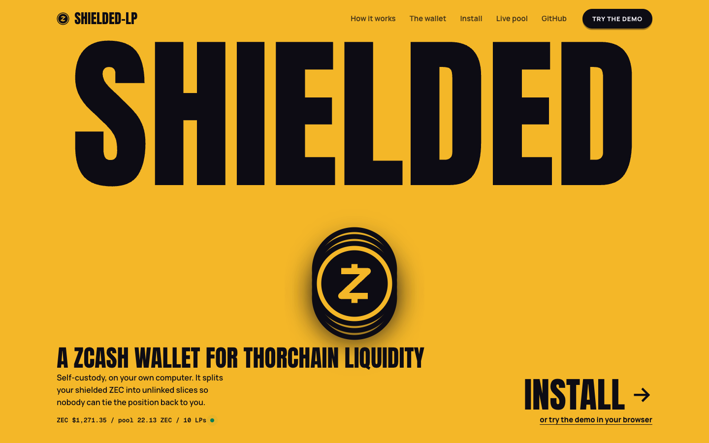
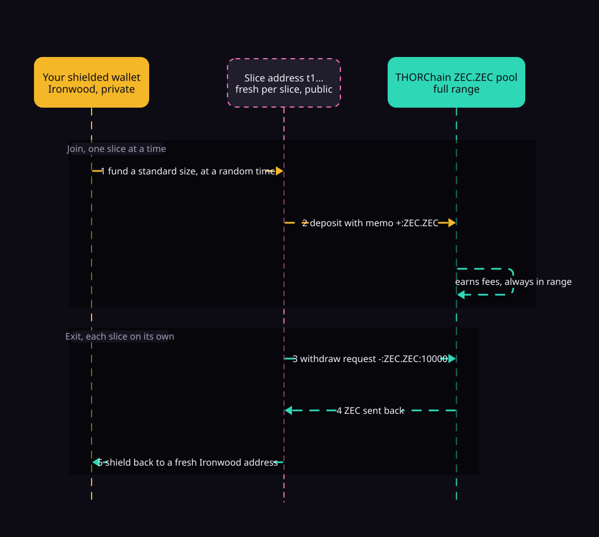
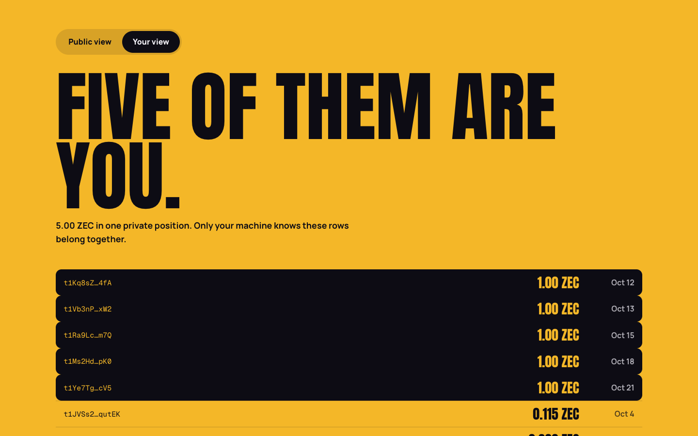
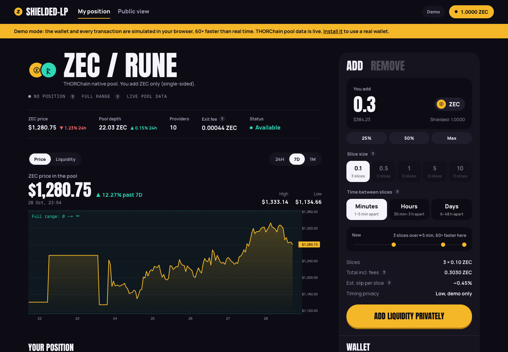
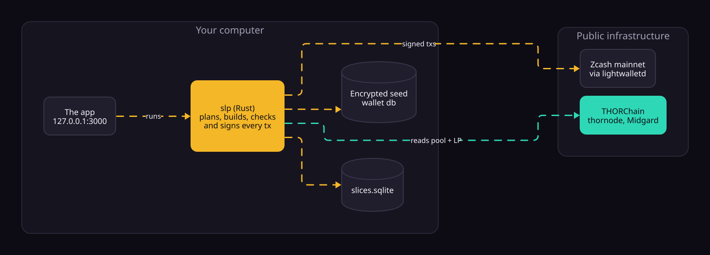
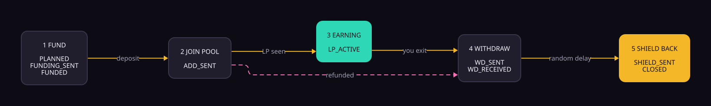

<p align="center">
  
</p>

<h1 align="center">shielded-lp</h1>

<p align="center">
  <b>Provide liquidity to THORChain's ZEC pool from a shielded wallet, without the position pointing back to you.</b><br>
  A self-custody Zcash wallet that runs on your own computer.
</p>

<p align="center">
  <a href="https://shielded-lp.vercel.app"><b>Live demo</b></a> &nbsp;|&nbsp;
  <a href="#install"><b>Install</b></a> &nbsp;|&nbsp;
  <a href="NOTES.md"><b>Verified facts and endpoints</b></a>
</p>

<p align="center">Built for <b>ZECATHON 2026</b>, track <b>Private Markets</b>, with a cross-chain angle (Zcash to THORChain).</p>

---

## The problem

- Zcash has no smart contracts, so there is no AMM on Zcash itself. Native ZEC liquidity lives on **THORChain**, whose ZEC pool went live on Oct 2, 2026 and is still shallow (about 22 ZEC deep).
- THORChain only reads transparent ZEC. A liquidity position belongs to the `t1…` address that deposited it, and anyone can look it up on Midgard.
- So a privacy-minded holder who wants to provide liquidity has to publish their size, timing and history from one address. Most don't, and the pool stays shallow.

## How it works

Your amount is split into **standard sizes** (for example 1 ZEC). Each slice is funded from the shielded pool to its **own fresh address** at a **random time**, joins the pool alone, and on exit is **shielded back** to a fresh Ironwood address.

<p align="center">
  
</p>

1. Reads your **Ironwood** shielded balance (the active shielded pool since NU6.3).
2. Splits the amount into standard denominations and schedules each slice with a random delay.
3. Derives a fresh transparent address per slice from your seed, funds it from the shielded pool (the sender stays hidden), then deposits single-sided ZEC with memo `+:ZEC.ZEC`.
4. Tracks every slice locally and shows you the **total position that only you can see**.
5. On exit, sends `-:ZEC.ZEC:10000` from each slice address, waits for THORChain's payout, then shields it back after a random delay.

## What the public sees, and what you see

<p align="center">
  
</p>

An observer sees several small, identical, unrelated positions, not "one whale added 500 ZEC". Only your machine knows which ones belong together.

| | Hidden from the public? | Why |
| --- | --- | --- |
| Which shielded wallet funded the slices | **Yes** | Shielded to transparent hides the sender |
| Your total liquidity | **Yes** (unlinked) | Only per-slice sizes are public |
| Where the money goes after exit | **Yes** | Shielded again to a fresh Ironwood address |
| Links between slices | Weakened | Standard sizes, random timing, fresh addresses |
| Timing patterns | Partly | The pool has few providers; use hours or days of spacing for real funds |
| Each slice's amount and address | No | Visible on Zcash and Midgard, by design |

We claim **unlinkable liquidity**, not invisible liquidity. The transparent hop is required because THORChain reads only transparent ZEC.

## The app

<p align="center">
  
</p>

It reads like a DEX position page:

- **Pool header** with live price, depth, providers, exit fee and status, each with its 24h change.
- **Price and liquidity chart** (24H, 7D, 1M) with your average entry price as a line and markers where your slices joined. Data comes from Midgard, with thornode archive state as a fallback so the chart never goes blank.
- **In range, full range.** THORChain pools are constant-product (x·y=k) at every price, so a position is always in range. The chart shows that range instead of a Uniswap v3 min/max.
- **Your position:** deposited, value now (after slip), slices in the pool, pool share. Every term has a short explanation on hover.
- **Your slices**, each with a five-phase progress bar: fund, join pool, earning, withdraw, shield back.
- **Add / Remove panel:** amount with 25% / 50% / Max, slice size (with the slice count), time between slices, a timeline preview, fees and estimated slip. Remove shows what you get back after exit fees.
- **Public view** tab: only what Midgard shows about your slices.

## The wallet

**shielded-lp is the wallet.** There is no "connect wallet" step: Zcash wallets do not yet let a website request these transactions (a deposit with a THORChain memo from a freshly derived address). You fund it from the wallet you already use, like Zashi, Ywallet or an exchange.

<p align="center">
  
</p>

- **Your keys.** `slp wallet init` creates a 24-word seed on your computer and stores it encrypted with an [age](https://age-encryption.org) key file (`identity.txt`). No account, no server, no custody.
- **Your slices.** Each slice address is derived from the same seed at `m/44'/133'/1000'/0/<slice id>`. Before signing, `slp` re-derives the key and refuses if the address does not match. Back up the seed plus `slices.sqlite` and every position can be recovered.
- **Your app.** The app runs at `127.0.0.1` and drives the local `slp` binary. Only signed transactions and public reads leave the machine.

## Install

Needs macOS or Linux, [Rust](https://rustup.rs), Node 20+ and [pnpm](https://pnpm.io). **This is hackathon software on mainnet: use amounts you can afford to lose.**

**1. Get the code and build it**

```sh
git clone https://github.com/riorblade/shielded-lp
cd shielded-lp
cargo build --release
```

**2. Create your wallet.** Press Enter at the prompt to generate a new 24-word seed. It is encrypted to `main/identity.txt`.

```sh
./target/release/slp wallet -w ./main/wallet init \
  --name main -i ./main/identity.txt -n main
```

**3. Write down your seed** and back up `main/identity.txt` (and `main/slices.sqlite` once you add liquidity).

```sh
./target/release/slp wallet -w ./main/wallet display-mnemonic \
  -i ./main/identity.txt --enable
```

**4. Start the app** and open http://127.0.0.1:3000/app

```sh
cd apps/dashboard
pnpm install
pnpm dev
```

**5. Fund it and add liquidity.** Click **Receive** for a shielded address, send ZEC to it from any wallet, then **Add liquidity privately**. Start small.

<details>
<summary><b>Prefer the command line?</b></summary>

```sh
alias slp=./target/release/slp
export SLP_NETWORK=main

slp address                               # fresh shielded address to fund
slp wallet -w ./main/wallet sync
slp wallet -w ./main/wallet balance       # Ironwood / Orchard / Sapling / transparent

slp plan --amount 0.3 --denoms 0.1 --jitter 30m-3h   # add --dry-run to preview
slp run                                   # resumable: stop and start any time
slp status                                # every slice + your total position
slp observer                              # only what the public sees

slp exit --all                            # withdraw every slice and shield back
```

To restore an existing seed instead of creating one: `slp wallet -w ./main/wallet restore-mnemonic --name main -i ./main/identity.txt -n main --birthday <height>`. Use a separate seed from your everyday wallet: two wallets running on one seed can step on each other. Every upstream devtool command is still available (`slp wallet …`, `slp inspect …`, `slp pczt …`).

</details>

## Ways to run it

| | Where | Wallet | THORChain | For |
| --- | --- | --- | --- | --- |
| **Demo** | [shielded-lp.vercel.app](https://shielded-lp.vercel.app), no install | Simulated in the browser (1 ZEC, 60× speed) | Live pool data, simulated deposits | Seeing how it works |
| **Mainnet** | Your computer (`-n main`, the app's default) | Your real wallet, keys stay local | Live ZEC.ZEC pool | Using it with real ZEC |
| **Testnet** (developers) | Your computer (`-n test`) | Real testnet wallet (TAZ) | Simulated by a vault key from your own seed | Testing the Zcash side without real funds |

Each network keeps its own wallet, identity and slice database under `./main/` or `./test/`, and `slp` refuses to run a wallet on the wrong network. The app shows the testnet switch only once a `./test/wallet` exists.

<details>
<summary>How the testnet mode works</summary>

THORChain has no testnet ZEC pool, so a vault key derived from your seed (BIP-44 account `slice_account + 1`) plays the vault: it credits the position when the deposit is mined and answers a withdraw request with a real outbound transaction (`OUT:<txid>` memo, minus a 44,132 zat fee). Every Zcash transaction is real. The code path is the same as mainnet except for the vault. Public TAZ faucets were offline or rate-limited while we built this, so testnet coins may take a manual request on the Zcash forum.

</details>

## Under the hood

Each slice moves through a resumable state machine stored in `slices.sqlite`. Stop `slp run` at any point and it picks up where it left off.

<p align="center">
  
</p>

**How each transaction is built**

- **Add:** inputs are the slice's UTXOs. Output 0 pays `denom` to THORChain's ZEC vault (published as a ZIP-320 `tex1…` address and decoded to the same-hash `t1…`). Output 1 is the OP_RETURN `+:ZEC.ZEC`. Output 2 returns change to the **same** slice address, because a single-sided position can only be withdrawn by the address that created it.
- **Withdraw:** the same shape, sending `dust_threshold + 1000` zat with memo `-:ZEC.ZEC:10000`.
- **Shield back:** all slice UTXOs into one Ironwood note at a never-used address of your wallet.
- ZIP-317 fees, and a v5/v6 transaction for the live consensus branch (v6 / NU6.3 today, so the NU7 rule that rejects v4 does not affect us).
- **Pre-flight before every send:** ZEC is not halted, LP actions are not paused, the pool is `Available`, the memo fits in 80 bytes, and the signed transaction pays exactly the planned outputs. If any check fails, nothing is broadcast.

**Where things live**

| Piece | Where |
| --- | --- |
| CLI `slp` (wallet + our commands) | `crates/slp`, a fork of [zcash-devtool](https://github.com/zcash/zcash-devtool) (MIT/Apache-2.0) |
| Our Rust code | `crates/slp/src/slp/`: `planner.rs`, `store.rs`, `thor.rs`, `chain.rs`, `mod.rs` |
| App and landing page | `apps/dashboard` (Next.js) |
| Diagrams | `docs/diagrams/*.d2`, made with [D2](https://d2lang.com). Re-render with `d2 flow.d2 flow.svg` |
| Verified facts, endpoints, txids | [`NOTES.md`](NOTES.md) |

## Tests

```sh
cargo test --release slp::
cd apps/dashboard && pnpm test   # simulator: plan, run, exit ends fully shielded
```

They cover denomination splitting, jitter parsing, the state store, memo building and the 80-byte limit, outbound and refund parsing, TEX to `t1` decoding of the live vault, deterministic slice keys, a **signed add transaction that round-trips and decodes with the expected outputs (v6, 15,000 zat ZIP-317 fee)**, and a **shield-back transaction built into the Ironwood pool**.

## Proof on mainnet

See the txid table in [`NOTES.md`](NOTES.md#demo-txids-fill-in-during-the-mainnet-run). It gets filled in during the first mainnet run.

## Limitations

- **Single-sided economics.** An asymmetric add loses a little to slip, and the position carries ZEC/RUNE price exposure. The pool is shallow (about 22 ZEC), so a 1 ZEC slice is roughly 4–5% of depth. This is not a yield product.
- **Small anonymity set.** Few people provide ZEC liquidity on THORChain today, so timing analysis is easier than we would like. Use hours or days of spacing for real funds. A shared "slice calendar" that interleaves many users' slices is future work.
- **Slices are public one by one.** Per-slice size and address are on-chain by design.
- **The withdraw payout format** (`out_txs` in thornode's tx status) follows the thornode schema and still has to be confirmed by the first live withdraw (see NOTES.md).
- The wallet base is `zcash-devtool`, a developer tool that is not production-hardened. Desktop only; no hardware wallet or mobile support yet.
- Out of scope: dual-sided liquidity (the RUNE side) and the Maya shielded-memo path.

## Compliance note

This is self-custodial software. It holds no user funds, runs no pooled vault and operates no server: every action is a transaction the user signs locally from their own seed.
